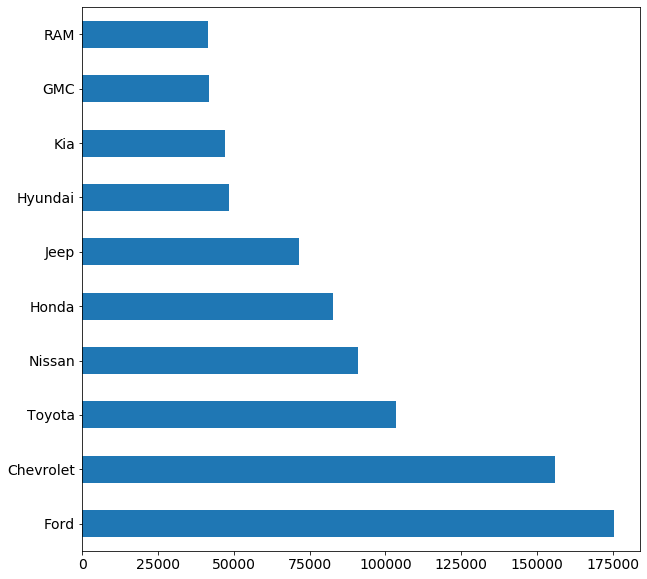
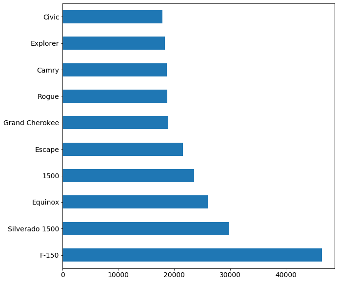
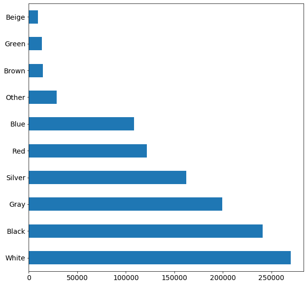

# Used Car Market Using Machine Learning

## Abstract
Cars.com (Cars) has a huge selection of user and dealership submitted cars for sale, this as well as its ease of scraping made it the ideal candidate for data collection.
Goal of this Machine Learning Project is simply:
* Train a model to predict the price of a car.

## Results
Original project (2020, ~100k cars.com listings, 9 features): gradient boosting RMSE **$8,396** against a median-price baseline of $19,298.

Current `Code/train.py` (LightGBM, raw-dollar target) on 14.14 million used vehicles (Craigslist 2021, ClassicCars.com, GSA auctions and all used-car records from the SEC loan filings), 20% held out:

| Model | RMSE | MAE | R² |
|---|---|---|---|
| Median-price baseline | $11,561 | $7,959 | – |
| LightGBM | **$3,708** | **$2,326** | **0.892** |

On the Craigslist listings, which have VINs and listing text, the RMSE is $4,567. What reduced the error, in order of effect: more rows, the sale year and month as features, VIN-decoded trim and engine specs and the listing-text flags (for rows that have them), LightGBM's native categorical handling instead of target encoding, the trim/transmission/engine/drivetrain/fuel/title columns, fitting dollars rather than log-dollars (lower RMSE, slightly higher MAE; `--target log` flips that), and 511 leaves per tree instead of 127 (better and fewer trees). CatBoost was tried and was worse alone; averaging it with LightGBM gained ~1% but costs far more training time. Splitting into separate models by vehicle age gained only ~2% and isn't done by default. `train.py` prints the error per source.

### How accurate is it, in practice?
Percentage errors on the held-out test set (2.83M cars), from the current model:

| Segment | Cars | Median error | Within 10% | Within 20% | Bias |
|---|---|---|---|---|---|
| All | 2.83M | 8.1% | 59% | 86% | +2.5% |
| $10,000–60,000, under ~8 years old | ~2.5M | 7–8% | 58–63% | 86–90% | ≈0 |
| $5,000–10,000 | 155k | 15% | 35% | 61% | +16% |
| Under $5,000 | 13k | 32% | 19% | 35% | +108% |
| Over $60,000 | 26k | 10% | 51% | 75% | −10% |
| Over 15 years old / classics | 21k | 20–39% | 15–29% | 28–49% | +21–49% |

Reliable as a valuation / screening tool for mainstream cars ($10k–60k, under about 8 years old, mileage known); not precise enough to set a final price without inspection, and not to be used for cheap, very old or collector cars, where condition, which no source records, dominates the price.

### Price range
Two more LightGBM models, fitted with the pinball loss to the 10th and 90th percentiles of the price
(`train.py --quantile 0.1` / `0.9`), turn the single estimate into the range 80% of such cars sell in.
`predict.py` prints it whenever `models/price_low.joblib` and `models/price_high.joblib` exist, and
`Code/evaluate_range.py` checks it on the test set. Results on the same 2.83M held-out cars:

| Segment | Cars | Inside the range | Below | Above | Median width | Width / estimate |
|---|---|---|---|---|---|---|
| All | 2.83M | 78.8% | 10.6% | 10.6% | $6,075 | 31% |
| $10,000–20,000 | 1.24M | 80.4% | 12.8% | 6.8% | $4,982 | 32% |
| $20,000–35,000 | 1.11M | 79.8% | 7.7% | 12.5% | $7,295 | 29% |
| $35,000–60,000 | 290k | 75.1% | 3.5% | 21.4% | $11,906 | 31% |
| Over $60,000 | 26k | 63.0% | 1.6% | 35.4% | $21,841 | 35% |
| Under $10,000 | 169k | 56–71% | 26–38% | 3–6% | $2,720–4,210 | 45–59% |
| 0–8 years old | 2.54M | 79% | 10.5% | 10.5% | $6,000–6,400 | 28–32% |
| Over 15 years old | 19k | 69.5% | 15.9% | 14.6% | $4,545 | 64% |
| Craigslist listings | 72k | 67.8% | 16.0% | 16.2% | $3,970 | 29% |
| Lender sale values (CarMax, Toyota, Santander, Carvana) | 1.5M | 78.6–79.4% | ≈10% | ≈10% | $5,500–7,400 | 27–35% |

The range is honest where the point estimate is reliable: for cars of $10k–35k under 8 years old, 80% of
sale prices land inside a band about 30% wide (±15% around the estimate). The width is itself a useful
signal, since it grows to 45–60% on cheap cars and over 100% on classics, where the point estimate should
not be trusted. The misses are one-sided at the extremes (prices below $10k mostly fall under the range,
prices above $60k mostly over it), the same bias the point model shows, so a price outside $10k–60k is
better reported with the range widened than as the 80% band.

The quantile models stop improving later than the point model (5,000 and 4,500 trees against 2,104), so
each takes about two hours to train on four cores.

## Data
Cars was scraped using 20 scraper programs running in parallel and stored locally on a M.2 Form Factor. 
Each datapoint represents a unique car being sold in the U.S. Cars.com refreshes the cars being shown on their website every couple of days. As such new data could be collected and added to total data set.

## EDA
In 2019 the used car market saw 40 million transactions, according to search results, as such the data being collected needed to be compared to the known distributions for the market. See below for graphs on data

* Make Distribution on the top 10




* Model Distribution on the top 10




* Color Distribution on the top 10




## Model
The general idea is to build a model that returns a price for a car given input feature information. Data was tested on a few different types of machine learning models. Gradient Boosting performed the best when compared to the baseline RMSE (average). Neural network is still a work in progress. 

### Output
The model outputs a price in USD. The raw scrape contained listings priced anywhere from $1,000 to $100,000,000; `Code/train.py` drops listings outside $500 - $500,000 (along with mileage over 500,000) as data-entry errors.

### Features
* Year
* Make
* Model
* Mileage
* City
* State
* Body Style
* Color

## Usage
```bash
pip install -r requirements.txt

# train on the scraped CSVs (headerless scraper output or combined CSVs with a header)
python Code/train.py carlist*.csv --scrape-year 2020

# price a car with the saved pipeline
python Code/predict.py --make Toyota --model Camry --year 2016 --mileage 45000 \
    --body-style Sedan --city Denver --state CO --color Silver

# optional: the 10th- and 90th-percentile models, so predict.py also prints the 80% price range
python Code/train.py carlist*.csv --quantile 0.1 --out models/price_low.joblib
python Code/train.py carlist*.csv --quantile 0.9 --out models/price_high.joblib
python Code/evaluate_range.py carlist*.csv     # coverage and width of the range on the test split
```

`train.py` compares a median baseline, ridge regression and gradient boosting, reports RMSE, MAE and R² on a
held-out test set, and saves the best model to `models/price_model.joblib` with its scores in
`models/price_model_metrics.json`. The saved file is a full scikit-learn pipeline (encoding + model), so it
predicts straight from raw values; only load model files you trust, since joblib/pickle files can run code
when loaded.

Each row the scrapers write ends with a `Date Scraped` column (YYYY-MM-DD, the day the listing was collected). CSVs scraped before this column existed still load; `train.py` keeps the earliest date when the same listing was scraped on several days, and measures car age from that date (or `--scrape-year` for undated rows).

### Collecting new data
cars.com now blocks automated requests, so new data comes from sources that allow collection:

| Script | Source | What it collects |
|---|---|---|
| `Code/collect_gsa.py` | [GSA Auctions](https://gsaauctions.gov) public API (US government surplus) | Cars and trucks at auction, with VIN, odometer and location. Run it daily: once an auction closes, its last bid is kept as the sale price. |
| `Code/collect_classiccars.py` | ClassicCars.com (collector cars) | Asking price, year, make, model and location from search pages; `--details` adds odometer, colors, transmission, engine, trim, VIN and title status. It obeys robots.txt, identifies itself, and waits 2 seconds between requests. Resumable. |

| `Code/import_absee.py` | SEC Form ABS-EE auto-loan filings (public records; parquet copies on Hugging Face by DenyTranDFW, spot-checked against EDGAR) | ~6.8 million financed vehicles from CarMax, Toyota, Honda, GM Financial, Ally, Santander, Ford Credit and others, 2010–2026: make, model, year, new/used, type, state, and the vehicle's value at the time of the loan (for CarMax, its retail sale price). No mileage, city or color. `--download` fetches the first three filings of each trust (~1.5 GB). |
| `Code/decode_vins.py` | NHTSA vPIC (free, no key) | Decodes every VIN in the data files into trim, body style, drivetrain, fuel, transmission, engine size, horsepower and doors (`data/vin_specs.csv`, resumable). `train.py` uses it automatically; on the Craigslist rows it cut RMSE 6% and MAE 9%. |
| `Code/import_craigslist.py` | [Used Cars Dataset](https://zenodo.org/records/10457828) (CC-BY-4.0; CC0 on OpenML) | 426,880 US Craigslist listings posted April–May 2021, converted to the same format, keeping the seller's condition rating and Yes/No flags read from the listing text (dealer listing, one owner, needs work, salvage mentioned, ...). On these rows the flags cut RMSE a further 5.6%. Download the zip from Zenodo first. |

`train.py` skips new-car records by default (`--include-new` adds them) and uses `Source` as a feature, so each lender's values are modelled separately from listing prices.

The collectors write to `data/` with a header row and a `Source` column, fill in body style, drive type, fuel and engine from VINs using NHTSA's free vPIC decoder, and can be passed straight to `train.py`, which uses `Source` as a feature (collector-car prices behave very differently from everyday used cars). Collected data stays local (`data/` is git-ignored); don't republish it.

To check whether cars.com still has the page format the scrapers expect, without starting a crawl, fetch a single page:
`python Code/fetch_one_page.py --zip 10001 --page 1`. It saves the page as HTML and reports how many rows the scraper parses from it (`--from-file` re-checks a saved page without a new request).

The scraped CSVs and `zip_code_database.csv` (used by the scrapers) are not included in this repository.
